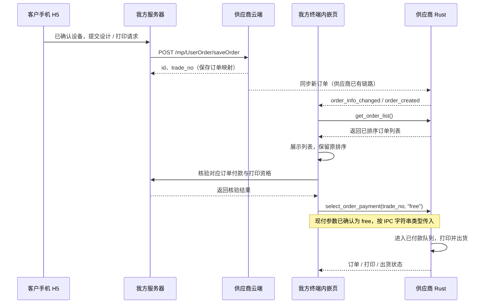

# 当前确认流程：云端下单 → 终端订单列表 → 现付 → Rust 打印

2026-11-03 用户与供应商确认本流程，替代此前“我方另行下发任务、终端再调用本地 create_order”的设想。用户随后确认新支付方式为 `pay_type=free`，替换此前的 `cash` / `100` 配置。依据 ZIP 的 `pay_type: string` 签名，调用时发送字符串 `"free"`；真实设备行为仍需联调。

## 顺序与职责

1. 客户手机扫描设备二维码，确认目标设备，完成设计。
2. 手机请求我方服务器，由服务器调用供应商 `POST /mp/UserOrder/saveOrder`。商家 authorization 保留在服务器，不进入公开 H5 或二维码。
3. 我方持久化本地订单、供应商 `business_number`、`id`、`trade_no` 与目标设备的映射。请求超时视为结果未知，不换业务号盲目重发。
4. 供应商负责把云端订单送到设备。内嵌页读取 `get_order_list()` 展示已排序列表，通过 `order_created` / `order_info_changed` 等通知刷新。
5. 内嵌页核验对应我方订单的支付、退款、目标设备和客户打印意图，再调用 `select_order_payment(trade_no, "free")`。不能因为某条订单出现在列表里就认为它已在我方付款。
6. 供应商让这种支付方式进入原有已付款队列，Rust 完成打印、出货。前端读取真实状态，不把 invoke 返回当成已经打印。

## 云端创建订单字段（文档已逐项核对）

文档：[创建订单](https://s.apifox.cn/00b6e711-5eb1-45bc-b9c7-3f177b29262f/api-503005298)。请求 `application/json`，路径 `/mp/UserOrder/saveOrder`。

| 字段 | 文档说明 |
| --- | --- |
| `business_number` | 字符串，毫秒时间戳 + 6 位随机数字；生成一次并持久化 |
| `shop_id` / `device_id` | 字符串，已确认的商家与设备 |
| `goods_id` | integer，商品 ID；示例写了字符串，但字段 schema 是整数 |
| `source` | integer，固定为 `1` |
| `product_pic_url` | 按商品模板尺寸处理好的打印图 URL；夹具款手机壳机、拼图机必填 |
| `picture_effect_url` | 展示用打印预览图，schema 为 string 或 null |
| `picture_origin_url` | 按商品模板尺寸处理好的打印图 URL；视觉识别款手机壳机必填。不能按字段名误传原始照片 |
| `language` | 可选语言代码，默认英文；示例 `zh` |

响应成功示例为 `{code:0,data:{id:0,trade_no:"string"},message:"string"}`；失败示例的 `code` 也填了 `0`，说明示例含占位值。尚未实际创建订单，不能把该占位码或 GET 库存接口的成功码直接当成已验证的下单成功条件。需要实际成功/失败响应或供应商确认错误码，并校验有效订单 ID / 订单号。

## 本次代码状态

- 已接 `get_order_list()` 展示，保留供应商顺序，显示机型/商品、订单尾号、状态和 effect_image 预览缩略图；不展示客户原图、金额或完整业务编号。
- `src/order-api.ts` 增加 `selectExternalPayment`；参数默认 `"free"`，可由 `VITE_EXTERNAL_PAYMENT_TYPE` 更换，不从 URL 接受支付方式覆盖。
- 调用前必须提供向我方服务器核验订单的 `ExternalPaymentVerifier`；核验后重查供应商订单，身份变化、退款/取消、非待支付状态均不再提交。
- 提交只表示支付方式已发送；超时结果未知，同实例不自动重复提交。后续以设备列表和事件为准。
- 本地 `create_order` 和下载图片辅助方法保留作旧方案参考，不从现有首页调用；当前新流程不能重复创建一张设备订单。
- 浏览器 `preview=1` 增加“订单列表”场景；不调用真实支付或打印。
- **尚未完成**：主项目的云端下单代理、最终打印图交付、订单关联持久化、终端向我方服务器的核验服务，以及 `pay_type="free"` 的真机验证。因此生产首页目前只显示列表，没有绕过核验的支付按钮，也未自动执行现付调用。

## 对接剩余事项

- [x] 用户已提供新支付方式 `pay_type=free`，调用参数改为字符串 `"free"`。
- [ ] 真机确认现付成功后的状态变化及进入打印队列的行为。
- [ ] 明确 `saveOrder` 成功/失败业务码、同业务号重复提交处理及超时后查询方式。
- [ ] 确认当前设备属于夹具款还是视觉识别款，以及打印图尺寸和字段要求。
- [ ] 完成我方订单与设备订单关联、核验服务、退款/重复打印互斥；不把前端传入的 paid 标记当作付款依据。
- [ ] 真机验证云端订单何时到达 `get_order_list()`、现付状态通知、Rust 打印与出货回传。

## 多客户终端看板

- 横屏同时显示扫码入口、当前打印和等待队列；窄屏上下排列，扫码入口保留。
- 当前任务以 `get_print_order()` 为准，展示订单尾号、机型、整体进度和备料 / 打印 / 出货阶段。
- 等待队列仅统计终端已确认支付且尚未开始打印的订单，保留 `get_order_list()` 的相对顺序；每页 3 条，每 8 秒自动轮播。
- 到场待确认、出货记录和异常单单独显示，不计入等待数；出货不代表已取件。不展示客户图片和完整订单号，不推算等待分钟数。
- 事件触发刷新，15 秒轮询兜底。进度读取前后核对当前订单号，不一致时隐藏本次百分比；原生接口仍应提供带订单号的原子进度快照，以彻底消除切单竞态。
- 看板支持多客户提交后的状态展示，硬件打印由 Rust 队列调度；本次 UI 不调用支付或打印指令。云端订单匹配和我方支付验证尚待对接。

## 到场确认与供应商支付状态（最新约定）

用户端推单在我方支付成功后进行。客户界面统一使用“待确认 → 等待打印 → 打印中 → 已出货”，没有再次付款步骤。新订单到达后显示提醒及订单尾号，客户在手机上确认到场，设备屏仅展示对应状态。

### ZIP 已确认与尚未确认的边界

- `get_order_list()` 仅声明“当前订单列表（已排序）”，没有声明只含已支付订单。不能据此判断所有列表项都已付款，也不能保证所有未付款订单都在列表内。
- `get_printable_order()` 明确是“是否有可打印的订单（已支付）”，但只返回布尔值。
- `parse_order_status()` 将设备 `pay_status != success` 归为 idle，success + print idle 才是 waiting。这是设备内部状态，不是我方收款状态。
- 需供应商确认：列表具体包含哪些状态、云端推单初始 `pay_status`、排序规则、`free` 放行后的状态/事件、是否保留原生现场未付款订单及区分来源的字段。
- 展示层暂将未放行（idle/paying）且 print idle 的订单归为“待确认”。我方支付真实性、退款及设备归属必须由服务器映射核验，不能仅凭这项展示分类调用 free。

### 当前实现范围（只读设备屏）

- 设备页面不提供按钮、选择器、可折叠信息或确认弹窗。语言从配置或启动参数读取；测试场景仅通过开发预览 URL 的 `scenario` 参数选择。
- 新订单提醒用设备/商家身份和订单号去重。首次读取建立基线，不把旧订单都标成新到达；读取失败保留去重状态，切换设备重新建立基线。
- 新订单到达后只展示提醒，提示客户在手机端核对订单并确认到场。设备页面不能确认到场、选择支付或发起打印。
- 宽屏待确认每页 2 条、待打印每页 3 条；窄屏分别为 1 条、2 条，每 8 秒自动轮播。订单事件触发读取，15 秒轮询兜底；初始化连接失败也自动重试。
- 手机端到场确认接口、订单校验与 free 放行的完整链路仍需对接。此改动仅调整设备展示页，不代表手机端确认功能已完成。

## 只读订单预览图

- 当前打印、待确认和等待打印列表显示订单自身的 `effect_image`，按完整订单 ID 关联。没有效果图时显示占位，不改用 `target_image` 打印原图。
- 图片使用 contain 完整展示，不裁剪设计、不添加交互。远程 HTTP(S) 图片直接读取；设备绝对本地路径通过 Tauri `convertFileSrc` 转为 asset 地址。
- 供应商需在 Rust 外壳中启用 asset protocol，仅放行订单预览图目录，并设置对应的 img-src CSP。当前仓库没有 Rust 外壳，不会擅自扩大本地文件访问范围。若返回相对路径，需供应商给出明确基准目录或可读取 URL。
- 缺失、无效或加载失败时保留订单及状态，只替换缩略图为占位；同一失败地址 60 秒内不重复加载。不记录图像地址或签名参数到日志。
- `public/preview-images` 是项目已有图库的小图副本，仅用于开发示例；正式订单不会用样例图替代真实效果图。真机图片路径及权限尚需联调。
