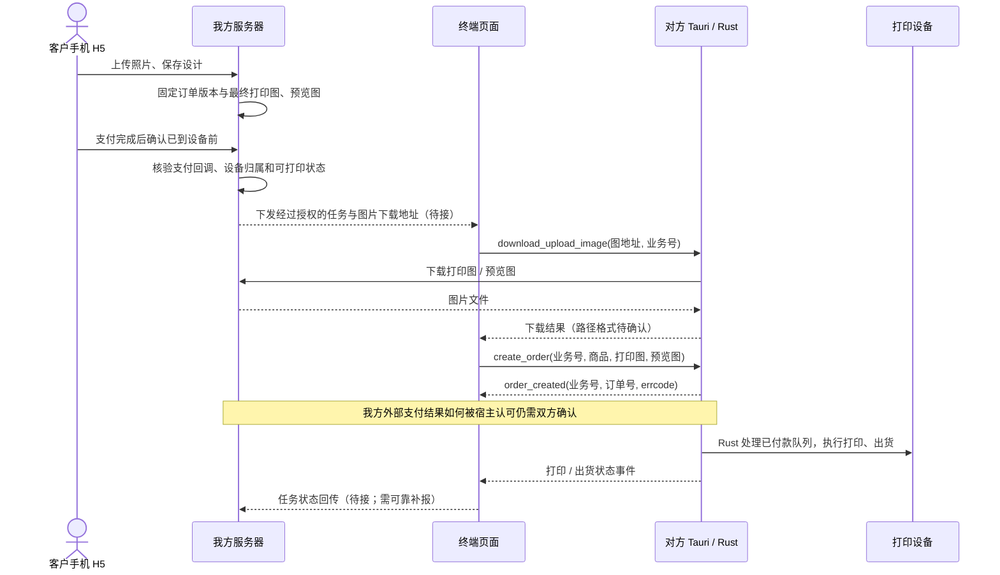

# 压缩包复核与手机图片交接（2026-11-03）

> 后续供应商沟通已明确采用 **云端 saveOrder 下单 → 终端原订单列表 → select_order_payment("free") → Rust 打印**。当前实施与待办见 [CLOUD_ORDER_FLOW.md](CLOUD_ORDER_FLOW.md)。本文保留原接口复核；下方“我方改造建议的图片流向”属于已替代的旧方案，不应继续按该图重复本地下单。

## 包里究竟有什么

原始压缩包只有 `api/` 下 13 个 TypeScript 文件，包含 `invoke` 调用封装、参数/返回类型、事件名和状态枚举。没有页面、调用流程案例、`package.json`、Rust 源码、`Cargo.toml`、Tauri 配置或安装包。部分文件依赖未提供的 `@/common/logger`。这些是可对照接入的接口代码，不是解压后就能运行的完整 App。

当前独立项目已实现扫码首页和终端状态读取。本次新增 `src/order-api.ts`、`src/native-order-api.ts`，封装下表中协议明确的业务号、图片、订单创建结果及查询；尚未挂到客户入口，不会自动向设备下单。

## 现有接口能做什么

| 步骤 | 已有接口 / 事件 | 已知与待核对边界 |
| --- | --- | --- |
| 获取设备身份 | `get_machine_info` | 设备、商家、H5 入口地址；已接首页 |
| 获取有货商品 | `get_stock_list`、`get_stock_material_by_id` | 有 `goods_id`；按约定下单只传商品，不指定货道 |
| 生成业务号 | `generate_business_number` | 返回字符串；必须关联我方订单并持久化，不能重试就换号 |
| 临时图片会话 | `order_session` 事件 | payload 有 `business_number`、`upload_img_url`；没有说明谁发起、图片上传 HTTP 协议，也不能把生成业务号等同于创建上传会话 |
| 下载图片 | `download_upload_image(url, business_number)` | 宿主执行下载并返回字符串；需确认返回值路径含义、缓存覆盖规则、校验和恢复能力 |
| 保存图片 | `save_canvas_image(data, business_number, filename)` | 注释为 base64，返回字符串；需真机确认是否支持 data URL 前缀及输出格式 |
| 创建订单 | `create_order(business_number, goods_id, target_image, effect_image)` | 接口存在；不需要凭空新增一个同名接口。打印图/效果图参数是否接受上面返回的本地路径需要供应商确认 |
| 判断创建结果 | `order_created` | 按业务号关联，检查 `errcode` 与 `trade_no`；`invoke<void>` 完成不等于业务成功 |
| 核对订单 | `get_order_by_id`、`get_order_list` | 可查询供应商订单，列表可按业务号查找；空列表不证明此前创建一定没有发生 |
| 支付 / 核销 | `select_order_payment`、`verify_order_pickup`、`use_order_pickup` | 对方自己的支付体系；没有直接接收我方 Airwallex 支付确认的已明确接口 |
| 查询可打印订单 | `get_printable_order` | 返回 boolean，**不是启动打印命令** |
| 正常开印 | Rust 处理已付款队列 | 用户结合产品介绍于 2026-11-03 确认；无需新增前端开始打印按钮。`start_testing_*` 是测试命令，不用于客户订单 |
| 打印 / 出货状态 | `get_print_order`、`get_print_progress`、`order_print_*` | 已接显示；不把 `print_success` 当成出货，也不把 `deliver_success` 当成已取件 |

## 原设备端流程（用户已确认）

2026-11-03，用户查看产品介绍后确认：手机只负责上传图片，客户在设备端编辑，编辑完成后在设备端选择支付方式；Rust 程序处理已付款队列。以下结合这一业务确认与 ZIP 的接口列出原流程。我们尚未取得原页面或 Rust 实现，也未完成真机验证。后面的“我方改造建议”仍是新方案，不是原流程；此次确认不自动改变我方手机编辑、Airwallex 支付的现有需求。

| 原设备上的操作 | 代码依据 | 证据边界 |
| --- | --- | --- |
| 首页展示、等待客户操作 | `get_media_info(home/inner)`、全屏设置、页面/编辑/支付超时 | 说明存在终端首页、编辑、支付等阶段；没有页面源码 |
| 选择品牌、系列、机型和材质 | `product.ts` 的库存过滤接口；`pclib.ts` 的底图、模板图、材质商品 ID | 终端能够选有货机型并拿到编辑模板；具体页面顺序未知 |
| 取得客户图片或选择图库 | `enable_wifi_transfer`、`enable_cloud_transfer`，`order_session` 的业务号/上传地址，`download_upload_image`，本地图库接口 | 用户确认手机用于上传图片；上传会话如何触发、二维码如何生成的调用细节未提供 |
| 在设备页编辑、合成 | `save_canvas_image` 注释“保存编辑的图片”，图库有背景/边框/纹理/贴图，机型有 `body_image` / `mask_image` | 支持终端页面完成编辑再保存；具体裁剪、合成与输出规则未提供 |
| 在设备创建订单 | `create_order(业务号, goods_id, target_image, effect_image)`，随后 `order_created` | 打印图与预览图分开，创建入参不指定货道；订单成功要核对事件 |
| 设备展示支付选项 | `get_qrcode_pay_types`、现金/刷卡/核销开关，`select_order_payment`，`order_qrcode_generated` | 用户确认编辑完成后在设备上选择支付方式；具体启用渠道取决于终端配置 |
| 支付后排队、打印、出货 | `pay_status`、`get_printable_order`、`get_first_order`、打印事件与抓取/打印/出货阶段 | 用户确认 Rust 处理已付款队列；前端负责查询和展示进度，异常、恢复、幂等细节仍需联调 |

因此原产品介绍中的手机 H5 是传图入口，设计与支付方式选择发生在设备屏。仅凭 `show_h5_entry` 字段不能推断原手机 H5 已支持完整设计和下单。

原流程为：设备选型 → 手机上传图片（或设备图库）→ 设备编辑 → 保存打印图/预览图 → 设备创建订单 → 在设备选择支付方式并完成收款 → Rust 处理已付款队列并打印/出货。生成业务号、传图会话和选型的精确先后顺序仍需原 App 确认。

## 我方改造建议的图片流向

下图是待实现的业务连接方案，不是已经完成的跨端链路。

终端页面负责接任务、调用接口和显示状态；大图片由 Rust 下载到设备本地。无需手机浏览器直接连接终端，也无需把完整图片先读进终端页面内存再转传一次。

需要分别保存用户原图、最终打印图与展示预览图，不能把界面截图/缩略图直接拿来打印。最终打印图应绑定不可变订单版本；具体像素尺寸、色彩/透明通道和模板定位规范仍以供应商确认的打印协议为准。

## 新增调用层如何验证

`tests/order-api.test.ts` 第一项是可运行的模拟联调案例：生成业务号 → 准备两张图片 → 创建订单 → 等待匹配业务号的 `order_created` → 查询订单付款状态。执行 `npm test` 即可，不调用真实终端或服务器。

- 保留供应商 snake_case 参数，不擅自改成其它字段名。
- 下载/保存结果为空时失败，不继续创建订单。
- 先监听结果事件，再发送创建命令；忽略其他业务号的事件。
- 创建超时/通信断开视为**结果未知**，先用原业务号查询，不能自动再次下单。
- 同一个客户端实例内相同业务号与内容复用同一次提交；不同内容拒绝提交。这不是跨重启的后端幂等保障。
- 用订单号查询时校验返回身份，查询结果只保留必要状态，不暴露图片路径和其他敏感字段。
- 支付、核销、测试打印、库存写操作没有接入此调用层。

## 最少需要供应商补充的内容

1. 含这批命令的定制 Rust / Tauri 工程或能加载我方前端的测试 App。
2. 已在我方付款的订单如何确认到供应商系统，并满足正常开印条件；是否复用原云端下单接口，由对方明确。
3. 图片函数返回值与 `create_order` 入参的实际例子，以及打印图规格。
4. 业务号幂等、设备接收任务、失败重试、库存扣减与出货状态回传约定。

详细问题和真机验收仍见 `INTEGRATION.md`。目前已有的 HTTP 商品/库存接口不等于手机已付款订单已经能送入本机打印队列。
